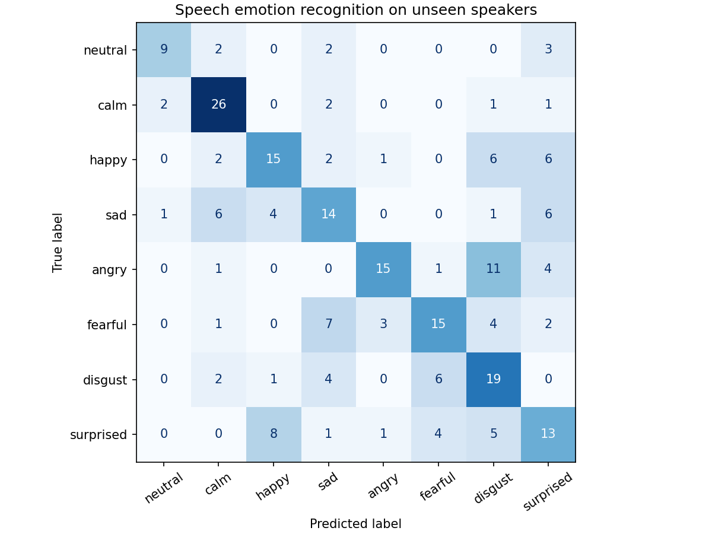

# CodeAlpha Task 2 — Emotion Recognition from Speech

This project classifies eight acted speech expressions: **neutral, calm, happy, sad, angry, fearful, disgust, and surprised**. It uses MFCC features from WAV recordings and a 1D convolutional neural network in PyTorch. The included checkpoint runs on CPU.

| CodeAlpha Task 2 requirement | Implementation |
|---|---|
| Recognize emotions in speech | `predict.py` predicts an expression for a WAV file and displays the top three scores. |
| Speech signal processing | `audio_features.py` converts audio to mono, resamples to 16 kHz, and pads or crops to four seconds. |
| Extract MFCCs | It computes 20 MFCC coefficients over 398 time frames. |
| Deep learning using a CNN, RNN, or LSTM | `model.py` defines a three-layer temporal CNN. |
| Use RAVDESS, TESS, or EMO-DB | `train.py` uses the 1,440 audio-only RAVDESS speech clips from 24 actors. |

## 1. Run the included demo on Windows

Extract the project ZIP and open the inner `CodeAlpha_SpeechEmotionRecognition` folder in VS Code. Open **Terminal → New Terminal**, then run these commands one at a time:

```cmd
py -3.12 -m venv .venv
.\.venv\Scripts\python.exe -m pip install -r requirements.txt
.\.venv\Scripts\python.exe -m pip install torch==2.15.0 --index-url https://download.pytorch.org/whl/cpu
.\.venv\Scripts\python.exe predict.py
```

The last command uses an included clip from held-out actor 08, selected because the model correctly predicts its labeled expression, **angry**. Open the WAV file in your media player to listen to the sample. To classify another WAV recording, supply its path:

```cmd
.\.venv\Scripts\python.exe predict.py "C:\path\to\your-recording.wav"
```

Use a clear, approximately four-second speech recording in WAV format. The model analyzes the first four seconds and zero-pads shorter clips. The training data uses acted English speech. Performance on new accents, recording conditions, and natural conversation may differ. Model scores have not been calibrated as probabilities, and the project classifies vocal expressions rather than establishing a person's emotional state.

## 2. Reproduce the training and evaluation

1. Open the [official RAVDESS download page](https://zenodo.org/records/1188976).
2. Download **Audio_Speech_Actors_01-24.zip** (about 209 MB). Create a `data` folder beside `train.py` and put the intact ZIP there.
3. Run the command below. All training is on CPU.

```cmd
.\.venv\Scripts\python.exe train.py
```

The split uses **16 training actors (960 clips), 4 validation actors (240 clips), and 4 test actors (240 clips)**. Each actor belongs to only one split. The code learns MFCC normalization and class weights from training data, selects a checkpoint using validation accuracy, then evaluates that checkpoint on the held-out test actors. See `outputs/metrics.json` for the actor IDs.

- `outputs/speech_cnn.pt` is the trained checkpoint.
- `outputs/metrics.json` records the splits and overall results.
- `outputs/test_report.txt` gives precision, recall, and F1 by emotion.
- `outputs/confusion_matrix.png` shows which classes were confused. Rows are real labels and columns are predictions.
- `outputs/test_predictions.csv` lists the expected and predicted expression for each test clip.

## 3. Recorded results

The CNN correctly classified **126 of 240** clips from unseen speakers (**52.5% accuracy**, **0.53 macro F1**). Predicting a single most frequent class would get 32 of 240 correct (13.3%). The selected checkpoint was from epoch 11 and reached 46.7% validation accuracy. One clear error pattern was angry speech predicted as disgust (11 of 32 angry test clips).



## 4. Explain your work and submit

| Time | What to show | Suggested on-screen text |
|---|---|---|
| 0–8 sec | README title | CodeAlpha Task 2 — Speech Emotion Recognition |
| 8–22 sec | MFCC extraction and CNN in the code | I converted speech audio into 20 MFCC features per frame and trained a 1D CNN to classify eight expressions. |
| 22–40 sec | Run `predict.py`, then show the prediction | This WAV is from a speaker held out of training. |
| 40–60 sec | Show the test report and confusion matrix | The test set contains 240 clips from four unseen speakers. Show the test accuracy and explain one confusion you see. |
| 60–70 sec | GitHub repository | Source code and test results are on GitHub. Link in the post. |

Create a GitHub repository named **CodeAlpha_SpeechEmotionRecognition**. Include the Python source files, README, requirements, model, outputs, and demo clip with its attribution. The ignore file excludes the environment and full dataset. To push from VS Code, create the empty repository first, then run these commands in the project folder. Replace YOUR_USERNAME with your GitHub username.

```cmd
git init
git add .gitignore README.md requirements.txt audio_features.py model.py train.py predict.py demo outputs
git status --short
git commit -m "Complete CodeAlpha speech emotion recognition project"
git branch -M main
git remote add origin https://github.com/YOUR_USERNAME/CodeAlpha_SpeechEmotionRecognition.git
git push -u origin main
```

Refresh GitHub and check for the source files, demo, and outputs. Publish the explanation video on LinkedIn with the GitHub link. The CodeAlpha brief also asks for an internship-status post tagging @CodeAlpha and submission through the official form in your WhatsApp group. Use the form instructions to submit Task 1 and Task 2.

## Dataset and demo attribution

Steven R. Livingstone and Frank A. Russo. (2018). *The Ryerson Audio-Visual Database of Emotional Speech and Song (RAVDESS)*. Zenodo. [doi:10.5281/zenodo.1188976](https://doi.org/10.5281/zenodo.1188976).

The demo clip is an unmodified audio-only speech file from this dataset. Its filename identifies the acted expression, intensity, statement, repetition, and actor. RAVDESS and the demo clip use the [CC BY-NC-SA 4.0 license](https://creativecommons.org/licenses/by-nc-sa/4.0/). The full training archive is available from the original authors through the link above.
